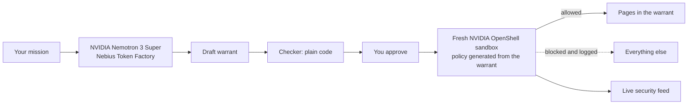

# Warrant

**Per-mission permissions for personal AI agents, with enforcement by NVIDIA OpenShell or a built-in check.**

Personal agents are most useful when they can act as you: read your portals, check your accounts, submit
things on your behalf. That also makes them dangerous. A page the agent reads can contain instructions,
and a plug-in can ask for more than it needs.

Warrant gives every mission a *warrant*: the smallest set of network requests the mission needs, written
in plain language, approved by you, and enforced at the network layer by an
[NVIDIA OpenShell](https://github.com/NVIDIA/OpenShell) sandbox. If the agent is fooled into reaching
anywhere else, the request is blocked, logged and shown to you, and the mission carries on.

Built for the Nebius × NVIDIA Global AI Hackathon (Personal AI track).

**[Watch the demo](https://youtu.be/U3mQIKMDdmE)** · **[Try the live demo](https://warrant-demo.onrender.com)** (if it has been idle, the first load takes about a minute)

## How it works

1. **You write a mission.** "Every morning, check my course portal for announcements and deadlines and brief me."
2. **Nemotron drafts the warrant.** NVIDIA Nemotron 3 Super, served by Nebius Token Factory, chooses the
   smallest set of capabilities from a **reviewed catalogue**. It cannot invent hosts, wildcards or paths:
   rules come only from the catalogue.
3. **Code checks it.** A plain-code checker rejects anything too broad: unknown or altered capabilities,
   whole-site access, more than five sites, mission text changed since drafting, writes without per-run approval.
4. **You approve it** in plain words. Writing missions ask again on every run.
5. **OpenShell enforces it.** The warrant becomes an OpenShell policy (`network_policies`, REST endpoints,
   `enforcement: enforce`). Each run gets its own sandbox.
6. **You see everything.** Allowed and blocked requests, Nemotron calls, tokens and cost stream to the
   interface while the agent works.



## Verified so far

With real services, from 26 October 2026. Details in `docs/verification/openshell-deciding-check.md`.

| Check | Result |
|---|---|
| Nemotron 3 Super drafts warrants for 4 missions | Minimal capabilities chosen each time; writing missions marked "ask every run"; checker passed |
| Warrant policy inside a real OpenShell 0.1.5 sandbox | Allowed GET returned 200; POST, an unlisted path and an unlisted host were denied, with OpenShell's own reasons |
| Over-reach evaluation, 5 scenarios x 2 repeats, OpenShell enforcing the warrant runs (30 October) | Broad access: 24 of 24 off-warrant requests went through. Warrant: 0 of 17. Expected fact in 4 of 10 answers in both. Summary only; raw logs were not kept |
| Same evaluation with raw records kept (31 October) | Broad access: 19 of 19. Warrant: 0 of 15. The portal's own log agrees: 19 and 0 arrived. Raw logs and a recount script are in `eval/evidence`. Expected fact in 4 of 10 answers in both |
| Live GitHub API in an OpenShell sandbox (30 October) | Reading issues allowed; OpenShell blocked the agent's attempt to post one. No token was set |
| Full mission under OpenShell | Fresh sandbox per run, agent read only the 2 warrant pages from inside it, Nemotron wrote a correct brief, sandbox deleted |

## What is in this repository

| Path | What it is |
|---|---|
| `src/warrant/models.py` | Missions, capabilities, rules, warrants and their fingerprints |
| `src/warrant/sites.py` | The reviewed capability catalogue |
| `src/warrant/compiler.py` | Nemotron drafts a warrant from the catalogue |
| `src/warrant/checker.py` | Fixed rules with the final word |
| `src/warrant/policy.py` | Warrant → NVIDIA OpenShell policy YAML |
| `src/warrant/enforce/` | Request gate, local development enforcer, OpenShell CLI backend |
| `src/warrant/agent/` | Tool-using agent used for local development and repeatable runs |
| `src/warrant/runner.py` | Runs a mission under its warrant and records every event |
| `src/warrant/api.py` | FastAPI service, including a live event stream |
| `src/warrant/memory.py` | Notes, remembered refusals and last answers |
| `src/warrant/guard.py`, `prove.py`, `local.py` | `warrant guard`, `warrant prove`, and the terminal flow |
| `web/` | React interface (missions, warrant approval, live run view, reviewed sites) |
| `FEEDBACK.md` | Notes on Nebius and NVIDIA tools gathered while building |

## See the difference

The quickest way to try it is the `judge-kit` folder: download it, then run `run-windows.bat` or `run-mac-linux.sh`.


A scripted agent tries to read your grades, submit your lab and send your data to a stranger, once with broad access
and once under a warrant. The result is read at the receiving end. No model or key is involved, nothing leaves your
machine, and it uses the built-in enforcer. The same check is in `tests/test_prove.py`.

```bash
uvx --from git+https://github.com/TheClazer/warrant warrant prove
```

## Try it in your terminal

Needs [uv](https://docs.astral.sh/uv/) and a Nebius Token Factory key. This starts a fictional portal on your
machine, asks Nemotron what the job needs, lets you remove permissions, then runs the agent and shows what was
blocked and what changed:

```bash
uvx --from git+https://github.com/TheClazer/warrant warrant try
```

`warrant try "your own job"` runs a different job on the same portal. Reviewed sites are listed in `src/warrant/sites.py`.

## Use it on your real sites

Say what an agent may ever do on a site or API. Once you have added one, the fictional portal is gone and every job
runs on your sites. You are the reviewer: the model can only pick from your list.

```bash
uv tool install git+https://github.com/TheClazer/warrant
warrant site add github https://api.github.com \
  --read /repos/my-name/my-repo/issues \
  --write /repos/my-name/my-repo/issues \
  --token-env GITHUB_TOKEN
warrant try "What are the newest issues on my repository?"
```

Sites live in `~/.warrant/sites.yaml`. A token stays in its environment variable, is never saved, and is sent only to its
own host on a request the warrant allowed. Warrant cannot log in through a website's sign-in page yet, and tokens are
sent by the built-in enforcer only, not yet inside an OpenShell sandbox.

## Memory and skills

Warrant keeps three things in `~/.warrant`: notes you ask it to remember, permissions you removed from a job (left out
of later drafts of that job), and its last answer to a job. Memory is background for the agent and can never widen a warrant.

A skill is a job with the warrant you approved, saved by name. It reruns without asking the model for new permissions,
and jobs that change something still ask on every run.

```bash
warrant remember "I only care about CS301"
warrant memory
warrant try "Find my exams this week" --save-as exams
warrant skill run exams
```

## Guard a program you already have

`warrant guard` runs a local program with its web traffic limited to the hosts you list, and prints each decision.
No model is involved.

```bash
warrant guard --allow api.example.com -- python my_agent.py
```

Or import it, on Python 3.11 or 3.12 (`pip install git+https://github.com/TheClazer/warrant`):

```python
import httpx
from warrant import guard

with guard(allow=["example.com"]) as report:
    httpx.get("https://example.com/")   # goes through
    httpx.get("https://www.iana.org/")  # raises httpx.ProxyError
print(report.blocked)
```

This is cooperative: it uses the standard proxy environment variables, which a program can ignore, and for HTTPS it
limits hosts rather than individual pages. For enforcement a program cannot opt out of, use NVIDIA OpenShell.

## Run the web app locally

Requires Python 3.11, [uv](https://docs.astral.sh/uv/) and Node 20+.

```bash
uv sync
cd web && npm install && npm run build && cd ..
export NEBIUS_API_KEY=...            # Nebius Token Factory key
uv run warrant serve --port 8090
```

Open http://127.0.0.1:8090. Without `NEBIUS_API_KEY` the interface works, but drafting and running are
disabled and say so.

### With NVIDIA OpenShell

Set `WARRANT_ENFORCER=openshell`. Each run then gets a fresh sandbox created from its warrant, built from
`deploy/sandbox.Dockerfile`:

```bash
docker build -t warrant-sandbox:dev -f deploy/sandbox.Dockerfile deploy
```

OpenShell needs Linux (or WSL 2) with Docker Engine; Docker Desktop does not work as the engine on WSL.
When the app runs on Windows and OpenShell runs in WSL, set `WARRANT_OPENSHELL_CMD="wsl -d Ubuntu -- openshell"`.

Without OpenShell, requests go through the in-process development enforcer, which applies the same decision
logic as the OpenShell policy. The interface says which enforcer each run used.

## Public demo

`Dockerfile` builds one container with the app and the fictional portal; `render.yaml` deploys it on Render's
free plan (New > Blueprint > this repository, then enter `NEBIUS_API_KEY`). The public demo uses the
built-in enforcer, because OpenShell needs its own Docker host. Daily caps on drafts and runs
(`WARRANT_DAILY_DRAFT_CAP`, `WARRANT_DAILY_RUN_CAP`) protect the Token Factory credits.

## Tests

```bash
uv run pytest
uv run ruff check src tests
uv run mypy
```

## How we use NVIDIA and Nebius

- **NVIDIA Nemotron 3 Super** (`nvidia/nemotron-3-super-120b-a12b`) drafts warrants and drives the agent.
- **Nebius Token Factory** serves Nemotron through its OpenAI-compatible API. Every call is recorded with
  tokens and latency; cost is shown when prices are configured from the Token Factory price page. It sped up the
  work because there was no model server to run: the same API call worked on a laptop, in the public demo and in the
  evaluation, and one run costs only a few thousand tokens.
- **NVIDIA OpenShell** enforces each warrant as a sandbox policy, on your own Linux or WSL 2 machine with Docker Engine.
  We did not use Nebius AI Cloud.

## Security model

Warrant limits **where the agent's requests can go**. Rules come from a list you reviewed, never from the model.

| Enforcer | Where the check runs | Good for |
|---|---|---|
| Built-in (default) | In the Warrant process, on the agent's own HTTP client | Trying it, and the public demo |
| NVIDIA OpenShell | In a separate sandbox and network proxy for each run | Stronger isolation of each request |

Things it does not do:

- **It does not inspect content.** Data can still leave through a request the warrant allows, such as an allowed POST or a query string. Grant write access sparingly.
- **It does not stop a page misleading the agent.** Pages are marked as untrusted, but that is guidance to the model, not a guarantee.
- **"Read-only" means GET.** A site whose GET requests change data should not be listed as a read.
- **The agent loop is not sandboxed.** With OpenShell, the requests run in the sandbox, not the agent itself.
- **Without an owner token the API is open.** It refuses other websites and, on loopback, foreign host names. Set `WARRANT_ADMIN_TOKEN` before exposing it to a network.

Warrant refuses paths containing encoded dots, slashes or backslashes (`%2e`, `%2f`, `%5c`, `%25`) with either enforcer, even if a site legitimately uses them. OpenShell 0.1.5 passes `%252e` and `%5c` on as written, so this protection covers the agent's requests. It would not cover another program running inside the sandbox; see `docs/verification/openshell-deciding-check.md`.

## Current limits

- It cannot log in through a website's sign-in page yet. Real sites work through APIs and pages reachable with a token or no sign-in.
- The agent is Warrant's own small tool-using agent. Running Hermes Agent inside the sandbox is planned, not done.
- The public demo uses the built-in enforcer; real OpenShell runs need a Docker host and are shown in the video.
- The evaluation is an over-reach test on a fictional portal, with OpenShell enforcing the warrant runs. It does not
  yet include planted prompt-injection pages. An earlier built-in enforcer run is kept in `eval/results-builtin`.
- It has not had an outside security review or real users. Treat it as early software.

## Honesty

The demo portal is fictional. Numbers shown in the interface come from recorded runs only. Warrant blocks
requests outside a mission's warrant; it does not stop a page from misleading the agent's answer, and it
does not stop misuse of access the warrant grants. Writing capabilities therefore ask on every run.

## Licence

Apache-2.0. OpenShell and Nemotron are the work of NVIDIA.
